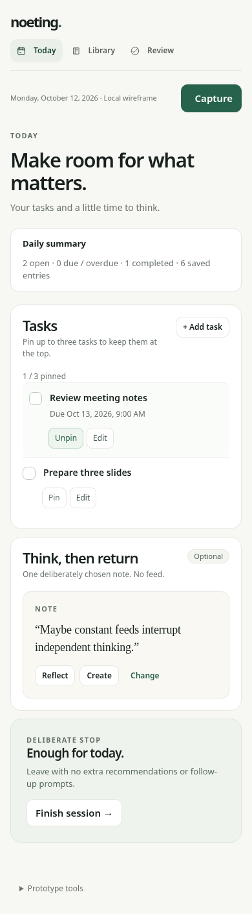

# Noeting

Noeting is a local-first mobile app for capturing notes and tasks, then choosing a small set of priorities for Today. The current M1 slice focuses on fast capture, durable offline storage, and a deliberately simple task list.



## Current features

- Capture a note or task while preserving the original text.
- Store data locally in SQLite without an account or backend.
- Complete tasks and pin up to three priorities.
- Keep the draft visible when a save fails so it can be retried safely.
- Avoid duplicate records when the same save request is retried.

Library, Review, reminders, export, sync, accounts, and AI features are outside this first implementation slice. See [the roadmap](04_ROADMAP.md) for planned work and [the current-state handoff](06_CURRENT_STATE.md) for verified progress and open validation.

## Development

The project uses Expo, React Native, TypeScript, and Expo SQLite. Node.js 24 or newer is required for the repository tests.

```sh
npm ci
npm run check
npm start
```

Useful commands:

| Command | Purpose |
| --- | --- |
| `npm run check` | Run TypeScript checks and SQLite repository tests |
| `npm run export` | Export Android, iOS, and web JavaScript bundles |
| `npm run web` | Export and serve the web build locally |
| `npm run test:ui` | Run Playwright tests against the served web build |
| `npm run build:android:test` | Build and statically verify an ARM64 Android test APK |

Browser SQLite requires the headers provided by `npm run web`. For the full project workflow, architecture, and acceptance criteria, start with [00_START_HERE.md](00_START_HERE.md).

## Validation status

TypeScript checks and eight integration tests using real SQLite pass. Five browser tests have also passed against Expo SQLite WASM/OPFS, covering persistence, offline use after loading, pin limits, startup recovery, and failed-write retry.

Android APK verification and physical-device acceptance remain pending. Do not treat JavaScript exports or browser tests as proof of native runtime behavior.
